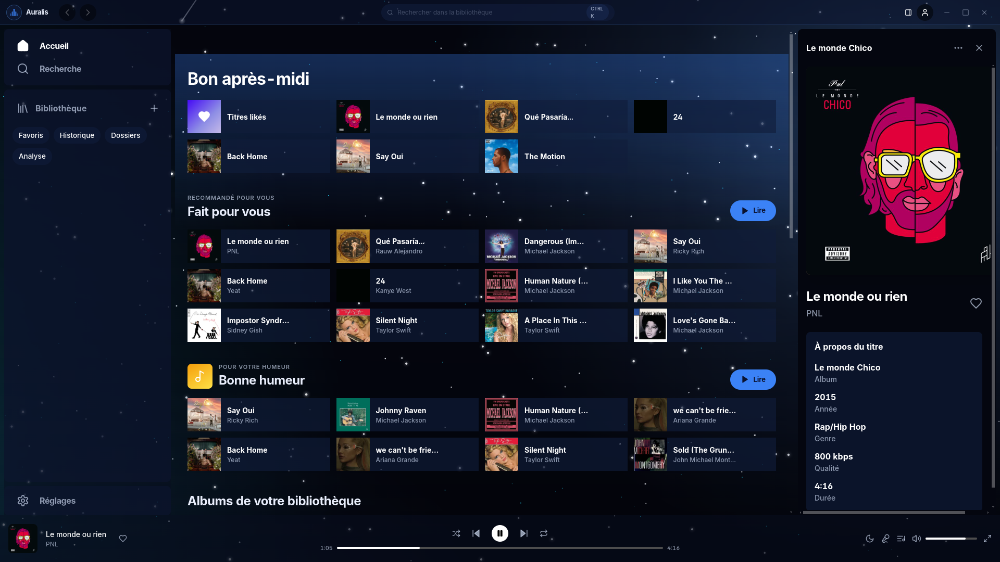
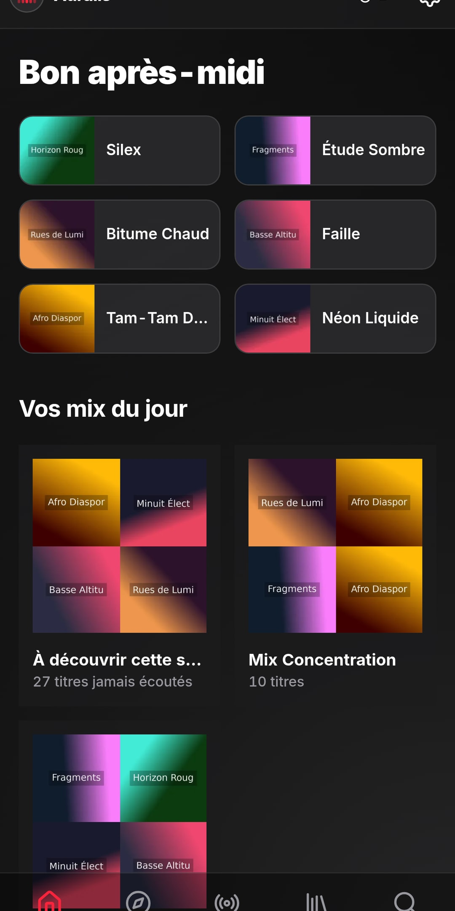
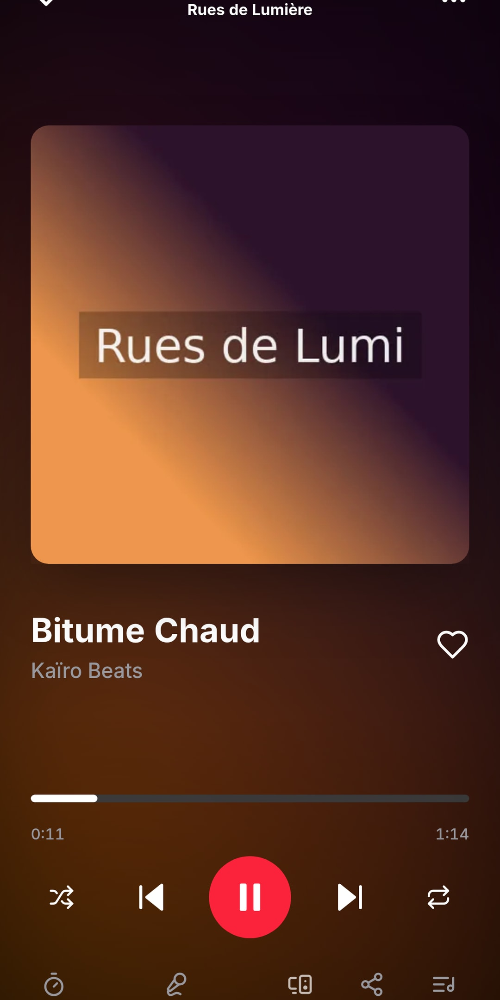

<div align="center">

# Auralis

**Self-hosted, local-first music player & streaming server with synced lyrics, real-time EQ, and native clients.**

[](https://github.com/ybenyedder/auralis/actions/workflows/ci.yml) [](https://github.com/ybenyedder/auralis/releases/latest) [](https://github.com/ybenyedder/auralis/releases) [](https://github.com/ybenyedder/auralis/releases/latest) [](./LICENSE)

[Preview](#preview) • [Architecture](#architecture) • [Getting Started](#getting-started) • [Testing](#testing) • [Building](#building) • [Docs](#docs) • [Contributing](#contributing) • [License](#license)

<br/>



</div>

---

## Preview

<div align="center">
  <table>
    <tr>
      <td align="center" width="50%">
        
        <br/>
        <sub><b>Mobile Home &amp; Daily Mixes</b></sub>
      </td>
      <td align="center" width="50%">
        
        <br/>
        <sub><b>Fullscreen Player &amp; Lyrics</b></sub>
      </td>
    </tr>
  </table>
</div>

---

> [!NOTE]
> Auralis runs as a single self-hosted Next.js 16 + SQLite server that powers the web PWA, Electron desktop app, and native Android/iOS clients with zero paid external dependencies.

---

## Architecture

One Next.js App Router server (with embedded SQLite and filesystem watcher) backs the web PWA, the Electron desktop shell, and the native mobile clients.

```text
auralis/
├── desktop/
│   ├── main.js              # Electron main process: window chrome, tray, updates, forks server
│   ├── preload.js           # Context bridge between renderer and Electron main process
│   ├── setup.html           # First-launch server URL setup view
│   └── updater.js           # Auto-update handler
├── android-native/          # Native Android client (Kotlin / Gradle)
├── ios-native/              # Native iOS client (SwiftUI / XcodeGen)
├── src/
│   ├── app/                 # Next.js App Router pages and HTTP API routes
│   ├── components/auralis/  # Player bar, fullscreen player, equalizer, lyrics, views, modals
│   ├── lib/auralis/         # Audio graph, i18n (FR/EN), mood engine, recommendations, themes
│   ├── server/              # SQLite DB/migrations, library scanner, lyrics sync, reco engine, auth
│   └── store/               # Zustand client state stores
├── deploy/                  # Dockerfile, docker-compose.yml, update.sh, backup.sh, .env.example
├── scripts/                 # Desktop packager, APK builder, audio alignment & sample music scripts
├── docs/                    # Architecture, design system, recommendation engine, native apps
├── test/                    # Vitest unit, security, route and UI test suite
├── electron-builder.yml
└── package.json
```

---

## Getting Started

### Prerequisites

- **Node.js** `v20+` (`v22` used in CI) and **npm**
- **Docker** and **Docker Compose** (optional, for server deployment)

---

### Setup

```bash
git clone https://github.com/ybenyedder/auralis.git
cd auralis
npm ci
cp .env.local.example .env.local
```

Edit `.env.local` to point `AURALIS_MUSIC_DIR` to your audio folder and `AURALIS_DATA_DIR` to where SQLite and cached artwork should live. You can generate a 27-track sample library with `./scripts/gen-sample-music.sh`.

---

### Running in Development

```bash
# Web / PWA dev server (http://localhost:3000)
npm run dev

# Electron desktop shell attached to dev server
npm run desktop:dev
```

---

### Self-Hosting with Docker

```bash
git clone https://github.com/ybenyedder/auralis.git /opt/auralis
cd /opt/auralis/deploy
cp .env.example .env
./update.sh
```

See [DEPLOY.md](./DEPLOY.md) for reverse-proxy setup, automated backups (`deploy/backup.sh`), and Pterodactyl egg configuration.

---

## Testing

```bash
# Unit, route and component tests (Vitest)
npm test

# Everything CI runs on a pull request: ESLint, TypeScript check and Next.js build
npm run check
```

---

## Building

```bash
# Production Next.js web server
npm run build

# Linux desktop packages (AppImage & .deb)
npm run desktop:build:linux

# Windows desktop installer (.exe)
npm run desktop:build:win

# Native Android APK
npm run mobile:native
```

Desktop installers and packages are placed in `dist-desktop/`. CI also builds signed desktop releases and Android/iOS artifacts from tagged commits (`v*`).

---

## Docs

- [Architecture](./docs/architecture.md): single-process server shape, routes and module boundaries
- [Design system](./docs/design-system.md): palette, glass surfaces, motion and responsive layout
- [Recommendation engine](./docs/reco-engine.md): MoodMix, audio embeddings and smart playlists
- [Native apps](./docs/native-apps.md): Android, iOS and Electron client notes
- [Deployment guide](./DEPLOY.md): Docker Compose, upgrades and backups
- [Google Play / TWA](./PLAYSTORE.md): Digital Asset Links (`assetlinks.json`), signing and store listing

---

## Contributing

Bug fixes, features, translations and docs improvements are welcome. Read [CONTRIBUTING.md](./CONTRIBUTING.md) before opening a pull request, and report bugs via [GitHub Issues](https://github.com/ybenyedder/auralis/issues). Security vulnerabilities should be reported privately per [SECURITY.md](./SECURITY.md). See [PRIVACY.md](./PRIVACY.md) for privacy details; redistribution terms are defined in [LICENSE](./LICENSE).

---

## License

Auralis is distributed under the **Auralis Attribution License v1.0** (MIT-based with mandatory attribution).

- **Allowed**: Personal and hosted usage, local builds, modifications, and forks.
- **Required**: Any public deployment, fork, or redistribution must preserve clear visible credit and link back to [https://github.com/ybenyedder/auralis](https://github.com/ybenyedder/auralis).

See [LICENSE](./LICENSE) for full terms.
